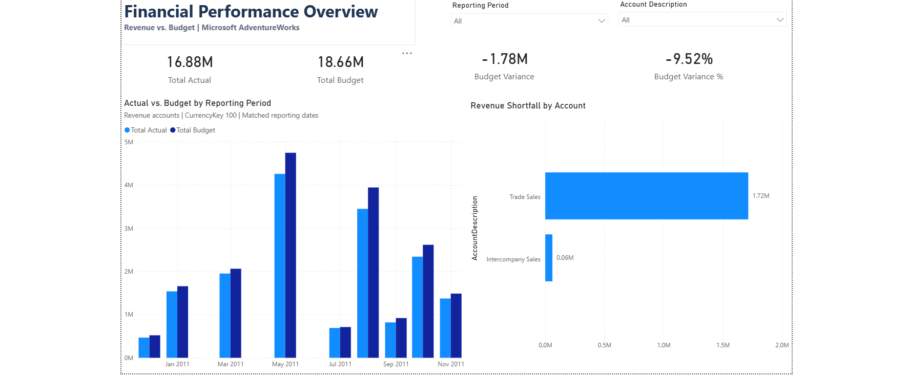

## Explore the Project

This project includes two interactive Power BI dashboards built using Microsoft AdventureWorksDW sample data.

### Dashboard Previews

**Dashboard 1: Financial Performance Overview**

Explore actual versus budget performance, investigate revenue shortfalls, and analyze financial variances by reporting period and account.

**Dashboard 2: Revenue & Profitability Overview**

Analyze sales revenue, product costs, gross profit, gross margin trends, and product-level profitability.

### Project Files

| Resource | Description |
|---|---|
| [Power BI Report (.pbix)](Power%20BI/Revenue_Margin_Intelligence.pbix) | Download the interactive two-page Power BI report |
| [Financial Performance Screenshot](Images/financial_performance.png) | Preview Dashboard 1 |
| [Revenue & Profitability Screenshot](Images/revenue_profitability.png) | Preview Dashboard 2 |
| [Prepared Datasets](Data/PowerBI_star) | Explore the nine financial and sales reporting tables |

### How to Explore the Dashboards

1. Download the Power BI report (`.pbix`) using the link above.
2. Open the file in Microsoft Power BI Desktop.
3. Navigate between the Financial Performance and Revenue & Profitability pages.
4. Use the reporting-period, account, and product filters to explore the data interactively.

**Note:** The report is currently available as a downloadable Power BI Desktop file rather than a public browser-based dashboard. All underlying data comes from Microsoft's AdventureWorks sample dataset.
