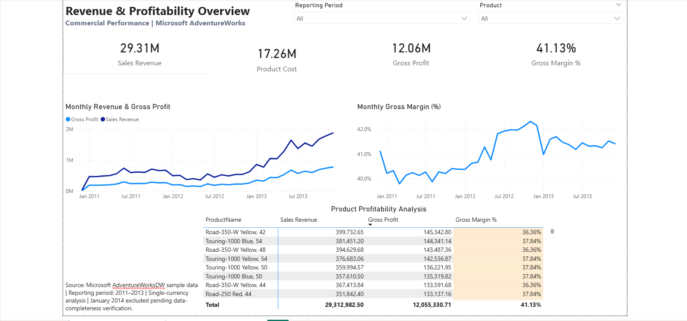

# Revenue & Margin Intelligence

### Financial Performance, Budget Variance & Product Profitability Analysis

**Power BI | DAX | Data Modeling | Financial Analytics | Business Intelligence**

A financial business intelligence project using Microsoft's AdventureWorksDW sample data to analyze revenue performance, budget variances, gross profit, and product-level profitability.

The project includes two interactive Power BI dashboards designed to turn financial and transactional data into actionable business insights.

**The objective:** Move beyond reporting financial totals to identify performance gaps, understand profitability patterns, and help business stakeholders determine where further investigation is needed.

---

## Explore the Project

| Resource | Description |
|---|---|
| [Download Power BI Report (.pbix)](Power%20BI/Revenue_Margin_Intelligence.pbix) | Complete interactive two-page Power BI report |
| [Financial Performance Dashboard](Images/financial-performance-dashboard.png) | Actual versus budget analysis |
| [Revenue & Profitability Dashboard](Images/revenue-profitability-dashboard.png) | Sales trends, gross margin, and product profitability |
| [Prepared Datasets](Data/PowerBI_star) | Nine financial and sales reporting tables |

**How to explore:** Download the `.pbix` file and open it in Microsoft Power BI Desktop. Use the reporting-period, account, and product slicers to investigate the results.

The report is currently distributed as a Power BI Desktop file rather than a publicly hosted interactive dashboard.

---

## Project Overview

Financial and commercial teams need reporting that answers more than "What happened?"

Effective business intelligence should help determine:

- How actual financial performance compares with budget.
- Which accounts contribute most to financial shortfalls.
- How revenue and profitability develop over time.
- Which products contribute the greatest gross profit.
- Whether financial performance is consistent across reporting periods.
- Where management should focus further investigation.

This project addresses these questions through two complementary dashboards.

| Dashboard | Primary Business Question |
|---|---|
| Financial Performance Overview | Where is revenue falling short of budget, and which accounts explain the gap? |
| Revenue & Profitability Overview | How are revenue, gross profit, and margins developing, and which products contribute most? |

The dashboards use separate financial and sales datasets with different historical reporting periods. Their totals are not presented as a single reconciled financial statement.

---

# 1. Financial Performance Overview


## Business Question

**How does actual revenue compare with budget, and where are the largest financial performance gaps?**

This dashboard compares actual and budgeted financial performance across matched reporting dates.

It combines financial KPIs, time-based comparisons, and account-level variance analysis to provide a management-oriented view of revenue performance.

### Dashboard Features

- Actual revenue KPI
- Budgeted revenue KPI
- Absolute budget variance
- Percentage budget variance
- Actual versus budget comparison by reporting period
- Revenue shortfall by account
- Interactive reporting-period and account slicers

## Key Financial Results

| KPI | Result |
|---|---:|
| Actual Revenue | $16,882,125 |
| Budgeted Revenue | $18,658,200 |
| Budget Variance | -$1,776,075 |
| Budget Variance % | -9.52% |

**Reporting scope:** USD financial records, selected revenue accounts, and matched actual/budget reporting dates during 2010–2011.

### Finding 1: Revenue Underperformed Against Budget

Actual revenue was approximately **9.52% below budget**, representing a financial shortfall of approximately **$1.78 million**.

This indicates a material deviation from the expected revenue performance within the selected reporting scope.

### Finding 2: The Revenue Gap Was Highly Concentrated

The account-level analysis showed that approximately:

| Account | Revenue Shortfall |
|---|---:|
| Trade Sales | $1.72M |
| Intercompany Sales | $0.06M |
| Total | $1.78M |

Approximately **97% of the overall revenue shortfall was concentrated in Trade Sales**.

This concentration suggests that treating the variance as a general financial underperformance issue would be less informative than investigating its largest contributor.

### Finding 3: The Largest Variance Deserves Priority

The analysis provides a starting point for prioritizing financial investigations.

A finance or commercial team could explore whether the Trade Sales shortfall is associated with:

- Changes in sales volume
- Pricing differences
- Customer demand
- Product mix
- Business or market conditions

These are potential investigation areas, not confirmed causes of the variance.

## Business Implication

The dashboard helps management move from identifying a revenue shortfall to identifying where investigative effort may have the greatest value.

By highlighting account-level contributions to financial variance, it supports more focused performance reviews and follow-up analysis.

---

# 2. Revenue & Profitability Overview



## Business Question

**How are sales revenue, gross profit, and margins evolving, and which products make the greatest contribution to profitability?**

This dashboard analyzes transactional sales data using aggregated financial measures, monthly trends, and product-level comparisons.

### Dashboard Features

- Sales revenue KPI
- Product cost KPI
- Gross profit KPI
- Gross margin percentage KPI
- Monthly revenue and gross profit trends
- Monthly gross margin trends
- Product-level profitability matrix
- Conditional formatting for gross margin comparisons
- Interactive reporting-period and product slicers

## Key Financial Results

| KPI | Result |
|---|---:|
| Sales Revenue | 29,312,982.50 |
| Product Cost | 17,257,651.79 |
| Gross Profit | 12,055,330.71 |
| Gross Margin | 41.13% |

**Reporting scope:** Historical transactional sales data during 2011–2013, using a single-currency reporting scope.

The values above are expressed in the underlying dataset's reporting currency.

### Finding 1: Revenue and Gross Profit Increased During 2013

The monthly trend analysis showed substantially higher reported revenue and gross profit toward the end of 2013 compared with earlier reporting periods.

Viewing these measures together provides a more informative perspective than revenue alone.

### Finding 2: Gross Margin Did Not Move Identically to Revenue

Monthly gross margin varied over time, generally around the low-40% range.

The analysis demonstrates that higher sales revenue does not automatically translate into a proportionate improvement in profitability.

This distinction is important when evaluating commercial performance because revenue growth and margin performance answer different business questions.

### Finding 3: Product Profitability Differs from Sales Volume

The product profitability matrix allows stakeholders to evaluate products using:

- Sales revenue
- Gross profit
- Gross margin percentage

The matrix is sorted by gross profit contribution and uses conditional formatting to make relative margin performance easier to interpret.

One example is **Mountain-200 Black, 46**:

| Metric | Result |
|---|---:|
| Sales Revenue | 1,373,469.55 |
| Gross Profit | 626,621.57 |
| Gross Margin | 45.62% |

This product's margin was approximately **4.49 percentage points above** the overall reported gross margin of 41.13%.

The example illustrates why product contribution and margin percentage should be evaluated together.

## Business Implication

The dashboard helps stakeholders distinguish between products generating substantial revenue, products generating substantial gross profit, and products achieving stronger margins.

Potential follow-up analyses could investigate product mix, pricing, discounting, and product costs.

The dashboard identifies performance patterns; establishing the causes of those patterns would require additional data and analysis.

---

# 3. Technical Implementation

## Data Source

The project uses Microsoft's AdventureWorksDW sample data.

The original data was transformed into reporting-ready CSV tables organized around financial and sales analysis.

The Power BI report uses separate fact tables with shared supporting dimensions.

### Financial Reporting Fact Table

`fact_finance_paired`

This table contains matched actual and budget observations with financial reporting identifiers and measures.

Relevant fields include:

- DateKey
- OrganizationKey
- DepartmentGroupKey
- AccountKey
- CurrencyKey
- RawActualAmount
- RawBudgetAmount
- SignedActualAmount
- SignedBudgetAmount
- SignedVarianceAmount

The paired structure supports comparison of actual and budgeted amounts within consistent reporting contexts.

### Sales Reporting Fact Table

`fact_sales`

This table supports transactional sales analysis, including:

- Sales revenue
- Product costs
- Gross profit
- Product-level profitability
- Monthly financial trends

### Supporting Dimension Tables

The reporting model includes:

- `dim_date`
- `dim_currency`
- `dim_account`
- `dim_organization`
- `dim_department`
- `dim_product`
- `dim_territory`

The model uses many-to-one relationships, allowing dimensions to filter the relevant financial and sales facts.

This structure supports reusable measures, consistent reporting filters, and separation of financial and commercial reporting scopes.

---

# 4. Financial Measures Using DAX

Reusable DAX measures were created to calculate financial KPIs across interactive report contexts.

## Financial Performance Measures

```dax
Total Actual =
SUM('fact_finance_paired'[SignedActualAmount])

Total Budget =
SUM('fact_finance_paired'[SignedBudgetAmount])

Budget Variance =
[Total Actual] - [Total Budget]

Budget Variance % =
DIVIDE([Budget Variance], [Total Budget])

Revenue Budget Gap =
[Total Budget] - [Total Actual]
```

The absolute variance calculation compares actual performance with budget.

The percentage calculation expresses the difference relative to budget, allowing the financial shortfall to be interpreted proportionally.

## Revenue & Profitability Measures

```dax
Sales Revenue =
SUM('fact_sales'[SalesAmount])

Product Cost =
SUM('fact_sales'[TotalProductCost])

Gross Profit =
[Sales Revenue] - [Product Cost]

Gross Margin % =
DIVIDE([Gross Profit], [Sales Revenue])
```

Gross margin is calculated using aggregated gross profit and aggregated revenue.

This approach avoids the misleading result that can arise from simply averaging individual product margin percentages.

---

# 5. Interactive Reporting and Filter Design

The dashboards were designed to allow stakeholders to investigate results without modifying the underlying data model.

## Reporting-Period Filtering

The original date dimension contained dates without corresponding fact records.

Using those dates directly in slicers could expose reporting periods with no available observations.

To restrict the available selections to periods represented in the financial dataset, a calculated column was created in the financial fact table:

```dax
FinanceReportingPeriod =
RELATED('dim_date'[YearMonthLabel])
```

The financial reporting-period slicer uses this fact-level field.

The sales reporting-period slicer follows the same approach:

```dax
SalesReportingPeriod =
RELATED('dim_date'[YearMonthLabel])
```

This ensures that the available slicer selections correspond to reporting periods represented in each respective fact table.

## Account and Product Filtering

The Financial Performance dashboard allows analysis by revenue account.

The Revenue & Profitability dashboard allows users to investigate individual products and examine their financial contribution.

These interactive controls enable more focused investigation while maintaining consistent KPI calculations.

---

# 6. Data Quality and Analytical Validation

A central objective of this project was producing financial reporting that could be interpreted reliably.

Several design decisions were made to address reporting accuracy and transparency.

## Actual and Budget Comparability

Financial actual and budget values were paired using matching reporting identifiers and dates.

The resulting analysis is limited to comparable observations rather than treating missing budget records as zero.

## Currency Consistency

The Financial Performance dashboard applies a USD filter using `CurrencyKey = 100`.

The commercial sales analysis uses a single-currency reporting scope.

Different currencies are not combined into one misleading financial total.

## Financial Sign Conventions

Financial actual and budget values use the prepared signed amount fields.

This maintains a consistent convention for financial reporting and variance calculations.

## Calculation Consistency

The financial measures support reconciliation of the displayed relationships:

**Financial performance**

```text
Budget Variance = Actual Revenue - Budgeted Revenue
Budget Variance % = Budget Variance / Budgeted Revenue
```

**Commercial profitability**

```text
Gross Profit = Sales Revenue - Product Cost
Gross Margin % = Gross Profit / Sales Revenue
```

These definitions make the reporting logic transparent and support consistent interpretation.

## Historical Reporting Coverage

The sales dataset contains a small amount of activity in January 2014.

The dashboard currently focuses on 2011–2013 because January 2014 contains substantially less reported revenue than preceding months.

The completeness of the January 2014 transaction period has not yet been independently confirmed.

Excluding that period prevents a potentially incomplete observation from being interpreted as a genuine commercial collapse.

## Separate Reporting Scopes

The financial and sales dashboards are not intended to reconcile directly.

They use different source facts, reporting periods, and analytical definitions.

The financial dashboard analyzes selected revenue actual/budget observations, while the commercial dashboard analyzes transactional revenue and product cost.

Presenting these as distinct analytical perspectives avoids implying that their totals constitute a unified financial statement.

---

# 7. Business Intelligence Skills Demonstrated

| Area | Skills Demonstrated |
|---|---|
| Financial Analytics | Budget variance, revenue analysis, gross profit, gross margin |
| Business Intelligence | KPI development, management reporting, interactive dashboards |
| Power BI | Report design, filtering, visual relationships, financial measures |
| DAX | Aggregations, calculated measures, ratios, filter context |
| Data Modeling | Fact and dimension tables, relational modeling, reporting relationships |
| Data Preparation | Reporting-ready datasets, structured financial records |
| Data Quality | Scope consistency, currency filtering, date coverage, calculation checks |
| Analytical Communication | Interpreting financial results and identifying investigation priorities |
| Business Decision Support | Turning performance differences into focused analytical questions |

The project demonstrates a combination of technical implementation and business-oriented analytical reasoning.

---

# 8. Repository Structure

```text
revenue-margin-intelligence/
|
|-- README.md
|
|-- Images/
|   |-- financial-performance-dashboard.png
|   |-- revenue-profitability-dashboard.png
|
|-- Power BI/
|   |-- Revenue_Margin_Intelligence.pbix
|
|-- Data/
    |-- PowerBI_star/
        |-- fact_finance_paired.csv
        |-- fact_sales.csv
        |-- dim_account.csv
        |-- dim_currency.csv
        |-- dim_date.csv
        |-- dim_department.csv
        |-- dim_organization.csv
        |-- dim_product.csv
        |-- dim_territory.csv
```

The repository currently contains the completed Power BI report, dashboard screenshots, and prepared reporting tables.

The upstream data preparation scripts and automated validation outputs are not included in this version.

These are potential future additions to improve reproducibility.

---

# 9. How to Run the Project

1. Clone or download this repository.
2. Install Microsoft Power BI Desktop.
3. Open `Power BI/Revenue_Margin_Intelligence.pbix`.
4. If Power BI requests updated data source locations, reconnect the CSV sources to the local `Data/PowerBI_star` folder.
5. Navigate between the Financial Performance and Revenue & Profitability pages.
6. Use the interactive slicers to investigate reporting periods, revenue accounts, and products.

**Note:** The report is designed for Power BI Desktop. GitHub can store and distribute the `.pbix` file but cannot render its interactive contents directly.

Both dashboard screenshots are available in the `Images` folder for immediate viewing.

---

# 10. Project Limitations

This is a portfolio project using historical Microsoft sample data, not an analysis of a live commercial organization.

Important limitations include:

- Financial budget comparisons cover selected matched reporting dates in 2010–2011, not complete annual financial statements.
- Financial and commercial sales data are analyzed separately and are not directly reconciled.
- The sales dashboard currently covers 2011–2013, excluding January 2014 pending transaction-completeness verification.
- Gross profit reflects recorded product costs and does not include all operating expenses.
- Financial findings identify patterns and potential investigation areas rather than verified causal explanations.
- No realized cost savings, revenue improvements, or operational outcomes are claimed.
- The repository does not yet contain the complete upstream preparation and validation workflow.

These limitations are documented to maintain transparency about what the analysis can and cannot establish.

---

# 11. Key Takeaways

This project demonstrates my ability to:

1. Translate business questions into measurable financial KPIs.
2. Build relational reporting models using fact and dimension tables.
3. Create reusable DAX measures for financial reporting.
4. Design interactive Power BI dashboards for different stakeholders.
5. Analyze financial variances and identify their largest contributors.
6. Evaluate commercial profitability through revenue, gross profit, and margin.
7. Recognize data-quality issues and document reporting limitations.
8. Communicate analytical results in a business-oriented way.

**The central principle of this project is that effective business intelligence should help stakeholders understand not only what happened, but also where to investigate and what decisions the available evidence can support.**

---

# Data Source

**Microsoft AdventureWorks Sample Databases**

https://learn.microsoft.com/en-us/sql/samples/adventureworks-install-configure

---

# Author

**Kyle Haustein**

MSc Chemistry | Data Analytics | AI Evaluation & Quality Operations

[Portfolio](https://orgo4ever.github.io/) | [GitHub](https://github.com/Orgo4ever) | [LinkedIn](https://www.linkedin.com/in/kyle-haustein-620a38126/)

